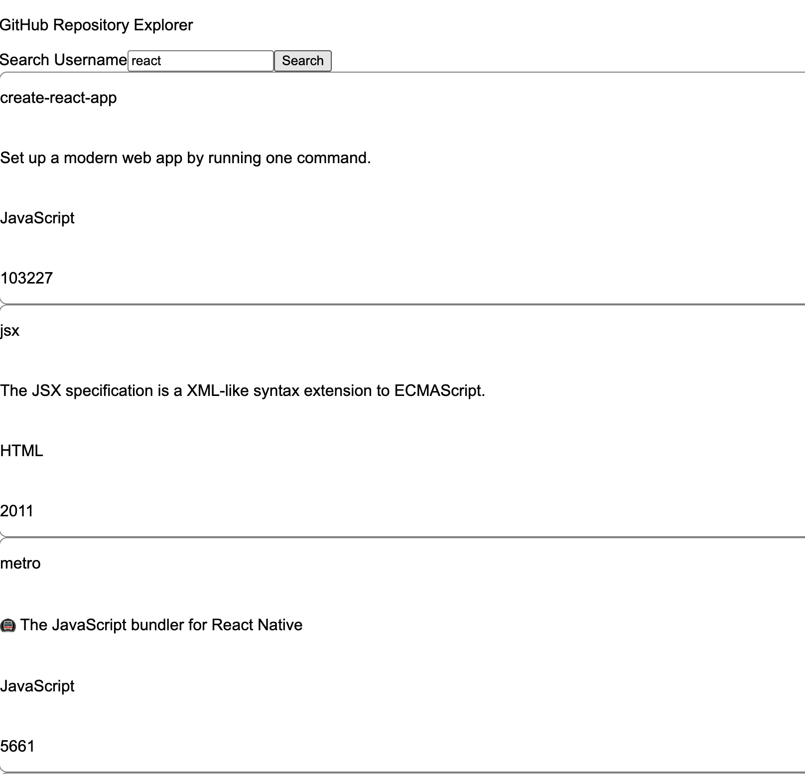

# GitHub Repository Explorer

A React and TypeScript application that allows users to search for GitHub repositories by username and explore repository information using the GitHub REST API.

Built to demonstrate asynchronous data fetching, type-safe React development, request cancellation, and component-based frontend architecture.

## Screenshot

## Features

- **GitHub User Search:** Enter a GitHub username to retrieve their public repositories.
- **Repository Listings:** Display repository information returned by the GitHub API.
- **Loading States:** Provide feedback while API requests are in progress.
- **Error Handling:** Handle failed API requests and invalid usernames.
- **Empty States:** Display appropriate messages when no repositories are found.
- **Request Cancellation:** Use AbortController to cancel previous requests and prevent stale responses from updating the UI.

## Tech Stack

- React
- TypeScript
- JavaScript (ES6+)
- Vite
- GitHub REST API
- CSS
- ESLint

## Architecture

The application separates presentation, data fetching, and state management into distinct components and modules.

### Key Components

- `GithubExplorer.tsx` — Main application component coordinating search, repository data, and UI states.
- `SearchFilter.tsx` — Handles GitHub username input and search interactions.
- `RepositoryList.tsx` — Renders the collection of repositories.
- `RepositoryCard.tsx` — Displays individual repository information.

### Supporting Modules

- `services/fetchRepositories.ts` — Handles GitHub API requests.
- `interfaces/Repository.ts` — Defines TypeScript types
